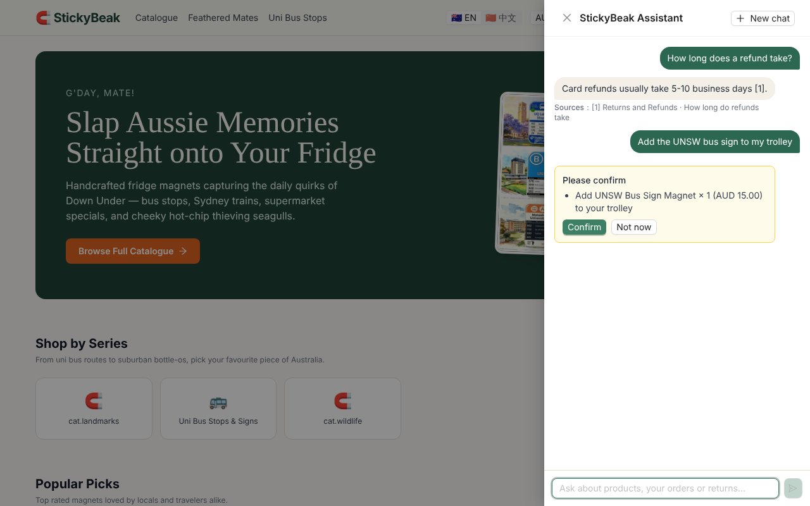

# Stickybeak 🧲🦜 企业级微服务电商中台

<div align="center">

[](https://spring.io/projects/spring-boot)
[](https://spring.io/projects/spring-cloud)
[](https://github.com/alibaba/spring-cloud-alibaba)
[](https://openjdk.org/)
[](https://react.dev/)
[](stickybeak-agent/README.md)
[](https://www.docker.com/)
[](LICENSE)
[](docs/SPRINT_ISSUES.md)

**基于 Spring Cloud Alibaba + React 18 的云原生澳大利亚风情文创跨境电商平台。**

[English](README.md) | [中文说明文档](README_CN.md) | [生产部署手册](docs/DEPLOYMENT_GUIDE.md) | [演示剧本与答辩指南](docs/DEMO_SCRIPT.md)

</div>

---

## 🌟 项目简介

> **StickyBeak** 源自澳大利亚俚语，原意为“爱凑热闹/好奇的人”，同时巧妙融合了 **Sticky**（磁贴/冰箱贴）与 **Beak**（鹦鹉鸟喙，平台特色吉祥物），主打澳大利亚特色文创磁贴与本土手作好物的跨境直邮。

**Stickybeak** 是一个按工业级标准打造的云原生分布式微服务系统，针对跨境电商中的高并发超卖、支付通知重复或丢失、跨服务订单状态不一致等问题做了完整的设计：
- **云原生微服务底座**：Spring Cloud Alibaba —— Nacos 服务发现 / 配置中心、Sentinel 网关限流、Seata AT 结账分布式事务；
- **严格有限状态机（FSM）**：订单每次流转都经过校验，并以条件更新落库，支付、超时、取消并发到达也不会写乱订单；
- **Stripe 跨境支付**：托管收银台支持银行卡、支付宝、微信支付；Webhook 验签、金额与币种校验、数据库唯一键幂等，并通过 Stripe Refund API 全额退款；
- **事件驱动履约**：RabbitMQ 主题交换机 + 手动 ACK + 重试队列 + 死信队列；延迟队列与兜底扫描实现 30 分钟未支付自动关单；订单确认邮件走 SMTP（本地 MailHog，生产 Amazon SES）；
- **商品全文检索**：Elasticsearch 8 + IK 中文分词，多字段加权匹配、高亮、相关度排序，ES 不可用时自动回退 MySQL；
- **AI 购物助手**：Python 服务（FastAPI + LangGraph），能导购、查询和取消订单，并基于中英双语知识库回答售后问题（ES 向量 + 关键词混合检索、RRF 融合与重排、回答附引用）；SSE 流式输出，所有写操作都要用户确认；
- **现代化双模前端**：React 18 + TypeScript + Vite + Redux Toolkit，商城端 TailwindCSS（PWA），管理端 Ant Design 5；
- **工程化质量门禁**：`mvn verify` 内置 JaCoCo 覆盖率门禁（订单状态机与 Stripe Webhook 处理强制行覆盖率 ≥ 90%），CI 中运行桌面端 + 移动端 Playwright 用户旅程，另有全链路接口 E2E 脚本。

---

## 🏗️ 整体架构图

```
                                [ 客户端浏览器 / 移动端 H5 ]
                                               │
                                               ▼
                              [ Nginx 生产反向代理 (:80 / :443) ]
                                (SSL/TLS, Gzip, SPA 路由兜底, 静态缓存)
                                               │
                                               ▼
                              [ Spring Cloud Gateway (:8080) ]
                           ├── JWT 鉴权，解析后注入 X-User-* 头
                           ├── Redis Token 黑名单即时吊销
                           ├── 剥离内部调用标识与 TX_XID 事务头
                           ├── Knife4j OpenAPI 3.0 文档聚合 (/doc.html)
                           └── Sentinel 限流（HTTP 429 JSON）
                                               │
            ┌──────────────────┬───────────────┴───────────────┬──────────────────┐
            ▼                  ▼                               ▼                  ▼
     ┌──────────────┐   ┌──────────────┐                ┌──────────────┐   ┌──────────────┐
     │  Auth Svc    │   │ Product Svc  │                │  Cart Svc    │   │  Order Svc   │
     │   (:8081)    │   │   (:8082)    │                │   (:8083)    │   │   (:8084)    │
     └──────┬───────┘   └──┬────────┬──┘                └──────┬───────┘   └──┬───────┬───┘
            │              │        │                          │              │       │
            │              │        ▼                          │              │       │
            │              │  [ Elasticsearch 8 + IK ]         │              │       │
            │              │  (商品搜索，故障回退 MySQL)       │              │       │
            │              │                                   │              │       │
            │              └──────── Seata AT（结账）──────────┼──────────────┘       │
            │                 [ Seata Server 2.0 (:8091) ]     │                      │
            ▼                       ▼                          ▼                      │
     [ MySQL 8.0 —— 各服务独立分库 ]            [ Redis 7（单节点）：库存、购物车、   │
                                                  缓存、Token 黑名单 ]                │
                                                                                      │
     ┌──────────────┐   order.paid / order.refunded   ┌─────────────────────────────┐ │
     │ Payment Svc  │────────────────────────────────►│ RabbitMQ（主题交换机、      │ │
     │   (:8085)    │                                 │ 延迟队列、重试、死信）      │ │
     └──────┬───────┘                                 └──────┬───────────────┬──────┘ │
            │                     order.paid（发邮件）       │               │        │
            ▼                  ┌─────────────────────────────┘               └────────┘
     [ Stripe API & Webhook ]  ▼                          支付成功 / 超时关单 / 退款
                        ┌──────────────┐
                        │ Notification │
                        │   (:8086)    │
                        └──────────────┘
```

---

## 💎 核心架构与技术亮点

### 1. 跨境支付与强幂等
- 校验 Stripe Webhook 签名（HMAC SHA-256，SDK 默认 300 秒防重放窗口），并在履约前核对实付金额、币种与支付记录一致；
- Stripe 事件 ID 唯一键（`uk_event_id`）让同一通知的并发重试只生效一次；
- 支付会话只能由订单服务创建，金额始终取自订单，不信任浏览器传值；
- 全额退款：管理员发起后调用 Stripe Refund API（带幂等键），由 `charge.refunded` Webhook 确认；订单已取消后才到账的支付会自动退款。

### 2. 严密的有限状态机（FSM）
- 订单生命周期：`pending → paid → processing → shipped → completed`、`pending → cancelled`、`paid / processing → refunding → refunded`；
- 非法或跳跃的流转抛出 `BusinessException`；每次流转都以 `UPDATE … WHERE status = <期望状态>` 落库，并发更新会失败而不是覆盖。

### 3. 分布式事务与防超卖
- 三层防超卖：Redis Lua 原子预扣 → 按商品的 Redisson 分布式锁 → MySQL 条件更新（`stock >= qty`）；
- 结账在 **Seata AT 全局事务**（`CheckoutTransaction`）中完成：商品库扣库存与订单库写订单要么一起提交、要么一起回滚；
- Redis 预扣按订单记账，事务没有提交（含 Seata 全局回滚 hook）时原子归还；
- 改到同一库存行的本地写（关单释放、退款回补、后台改库存）加 `@GlobalLock`；调用 Stripe 放在全局提交之后，外部 I/O 期间不占热门商品的全局锁。

### 4. 商品搜索
- Elasticsearch 8 + IK：名称 / 分类 / 标签 / 描述多字段加权匹配，名称高亮，相关度或列表排序；
- 后台修改在事务提交后增量重建索引，启动时与每日全量对账；ES 宕机或关闭时自动回退 MySQL。

### 5. AI 购物助手（Python）
- **LangGraph 状态图**：意图路由后交给导购 agent、订单 agent、RAG 售后节点或闲聊节点；每个 agent 只绑定自己的工具，工具调用现有 Java 服务；
- **安全由结构保证**：用户 ID 取自网关注入的 `X-User-Id`，由运行时注入工具，不是模型参数；加购、取消订单会让图暂停（`interrupt`），用户在卡片上确认后才执行，卡片内容由服务端查询；对话（包括等待确认的操作）存 MySQL，刷新页面、服务重启后都能继续；
- **回答有据可查**：kNN（text-embedding-v3）与 BM25（IK）两路结果经 RRF 融合、gte-rerank 重排并按分数过滤；没有相关资料时明确说不知道，不编造，回答附引用来源；
- **可运营**：通义千问为主、DeepSeek 备用（OpenAI 兼容接口），Redis 按用户限流与每日 token 额度，记录 token 用量与耗时，SkyWalking 跨 Java / Python 链路，50 条评测集（[详情](stickybeak-agent/README.md)）。



### 6. 可观测性、接口文档与质量门禁
- **SkyWalking 全链路追踪**：7 个服务都挂 Java agent，一条链路串起 gateway → order → cart / product / payment，以及支付成功后经 `order.paid` 异步到 order、notification 的处理；响应头带 `X-Trace-Id`，日志带同一个 traceId 并上报 OAP；
- **告警**：服务 / 端点的慢响应与错误率、慢 SQL、死信队列积压（订单服务上报的自定义指标）；
- **用链路数据做优化**：链路暴露出商品列表的 N+1 查询，改成批量查询后吞吐 64 → 191 req/s，p99 1.57s → 392ms（[详情](docs/PERF_PRODUCT_LIST.md)）；
- **Knife4j / OpenAPI 3.0**：各服务通过 springdoc 输出接口文档，网关 `/doc.html` 统一聚合；服务间内部接口单独标注；生产环境关闭；
- **JaCoCo 门禁**：模块行覆盖率低于底线时 `mvn verify` 直接失败；
- **Playwright 用户旅程**：搜索、游客结账、订单列表、后台退款，CI 中在 Desktop Chrome 与 Pixel 7 上运行。

---

## 📦 微服务项目模块划分

```
stickybeak/
├── stickybeak-gateway/        # Spring Cloud Gateway、JWT 过滤器、Sentinel、Knife4j 聚合
├── stickybeak-auth/           # 用户认证中心、RBAC 角色权限、地址簿管理
├── stickybeak-product/        # 商品中心、品类分类、库存流转、ES 搜索
├── stickybeak-cart/           # 分布式购物车（游客状态 + 登录合并）、心愿单
├── stickybeak-order/          # 订单状态机、Seata AT 结账、超时关单与退款
├── stickybeak-payment/        # 跨境支付抽象、Stripe 收银台、Webhook 与退款
├── stickybeak-notification/   # 邮件通知（RabbitMQ 消费 + SMTP：MailHog / SES）
├── stickybeak-common/         # 统一返回体、错误码、内部接口守卫、OpenAPI 配置
├── stickybeak-agent/          # AI 购物助手：Python 3.12、FastAPI、LangGraph、ES 上的 RAG、评测集
├── stickybeak-frontend/       # React 18 + Vite + Redux Toolkit + Tailwind + Ant Design，Playwright e2e
├── docker/                    # Docker Compose 编排（本地开发 & 生产）、Nginx、MySQL 初始化
├── docs/                      # 架构文档、数据库 ER 图、云上部署手册、演示剧本
└── scripts/                   # 全链路 E2E 验证脚本、数据初始化辅助脚本
```

---

## 🚀 快速启动指南

### 环境依赖
- **Java**: Eclipse Temurin JDK 17+
- **Node.js**: 20+ (包含 npm)
- **Docker**: Docker Engine 24+ & Docker Compose v2+

### 方式一：本地开发调试模式

```bash
# 1. 启动基础设施中间件（MySQL、Redis、RabbitMQ、Nacos、Seata、Elasticsearch、MinIO、MailHog）
docker compose -f docker/docker-compose-infra.yml up -d

# 2. 编译并启动后端微服务
# 在 IDE 中或终端启动 stickybeak-gateway, stickybeak-auth 等各个服务：
mvn spring-boot:run -pl stickybeak-gateway
mvn spring-boot:run -pl stickybeak-auth
# 或编译全部模块包：
mvn clean package -DskipTests

# 3. 启动前端商城与后台
cd stickybeak-frontend
npm install
npm run dev
# 前端本地访问地址: http://localhost:5173
```

### 方式二：全栈一键容器化部署

```bash
# 构建并启动全部微服务、前端及 Nginx 反向代理
docker compose -f docker/docker-compose.yml up -d --build
```
打开浏览器访问 **http://localhost** 即可畅享完整商城。

> 已有 MySQL 数据卷不会重新执行初始化脚本。升级后需手动执行一次 `docker/mysql/init/07-seata-undo-log.sql`（Seata `undo_log` 表）。

---

## 🎛️ 控制台与端口全景表

| 服务名称 | 端口 | 访问地址 | 默认账号 / 备注 |
| :--- | :--- | :--- | :--- |
| **前端商城 & 管理端** | 80 | `http://localhost/` | 前端 SPA |
| **微服务网关 (Gateway)** | 8080 | `http://localhost:8080` | 微服务统一入口 |
| **Knife4j API 聚合文档** | 8080 | `http://localhost:8080/doc.html` | 生产环境关闭 |
| **Nacos 注册与配置中心** | 8848 | `http://localhost:8848/nacos` | `nacos / nacos` |
| **Seata 控制台** | 7091 | `http://localhost:7091` | `seata / seata` |
| **RabbitMQ 消息中台** | 15672 | `http://localhost:15672` | `guest / guest` |
| **MailHog 邮件测试控制台** | 8025 | `http://localhost:8025` | 邮件实时查看 |
| **MinIO 对象存储中台** | 9001 | `http://localhost:9001` | `minioadmin / minioadmin` |
| **Elasticsearch 搜索引擎** | 9200（全栈）/ 19200（仅基础设施） | `http://localhost:9200` | 单节点，未开启安全认证 |
| **AI 购物助手** | 8087（内部） | 经网关 `http://localhost:8080/api/agent/health` | 需要 `DASHSCOPE_API_KEY` 或 `DEEPSEEK_API_KEY` |
| **SkyWalking UI** | 8088 | `http://localhost:8088` | 链路、拓扑、日志、告警 |
| **SkyWalking OAP** | 11800（agent gRPC）/ 12800（HTTP、GraphQL） | `http://localhost:12800/healthcheck` | 存储使用 BanyanDB |

---

## 🧪 自动化测试与覆盖率把关

### 1. 后端单元测试与 JaCoCo 覆盖率门禁
```bash
# 运行全部测试、生成 JaCoCo 报告并校验覆盖率底线
docker run --rm \
  -v "$(pwd):/workspace" \
  -v "stickybeak-m2:/root/.m2" \
  -w /workspace \
  maven:3.9-eclipse-temurin-17 mvn verify
```
测试报告生成于各模块路径：`stickybeak-<module>/target/site/jacoco/index.html`。当前行覆盖率（括号内为门禁底线）：

| 模块 | 行覆盖率 | 底线 |
| :--- | :--- | :--- |
| gateway | 74.3% | 65% |
| product | 62.5% | 55% |
| notification | 54.0% | 50% |
| cart | 53.9% | 50% |
| order | 49.9% | 45%（`OrderStateMachine` 100%，底线 90%） |
| payment | 45.2% | 35%（`WebhookServiceImpl` 97.2%，底线 90%） |
| auth | 30.5% | 30% |

### 2. 前端单元测试、类型检查与用户旅程
```bash
cd stickybeak-frontend
npm run typecheck    # TypeScript 类型检查（应用 + e2e）
npm run test         # Vitest 单元测试套件
npm run build        # 生产包编译验证
npm run e2e          # Playwright 用户旅程，Desktop Chrome + Pixel 7（接口在浏览器内模拟）
```

### 3. AI 助手测试与评测
```bash
cd stickybeak-agent
uv run ruff check . && uv run pytest -q   # 状态图、工具、RAG、接口、额度（脚本化假模型，不调用模型 API）
uv run python -m eval.run_eval            # 用真实模型跑 50 条评测，报告在 eval/reports/<时间>/report.md
```

### 4. 全链路 E2E 自动化回归验证
```bash
# 针对已启动的 Docker Compose 全栈：买家流程、Webhook 幂等、管理端操作、RBAC
node scripts/test-sprint8-e2e.js
```

---

## 🌐 生产环境云上线指南

有关在 **AWS (ECS Fargate + RDS Multi-AZ + ElastiCache + ALB)** 上的企业级生产上线方案：  
👉 **[点击阅读完整云部署手册 (docs/DEPLOYMENT_GUIDE.md)](docs/DEPLOYMENT_GUIDE.md)**

```bash
# 生产环境 Docker Compose 快速上线
docker compose -f docker/docker-compose.prod.yml --env-file docker/.env.prod up -d
```

---

## 🎬 产品路演与技术答辩剧本

需要向技术面试官、导师评审组或投资人展示 Stickybeak？  
👉 **[点击查看 3-5 分钟演示剧本与答辩攻略 (docs/DEMO_SCRIPT.md)](docs/DEMO_SCRIPT.md)**

---

## 📄 开源许可 (License)

本项目采用 **[Apache License 2.0](LICENSE)** 许可证。
由 Stickybeak 研发团队匠心设计与构建。
