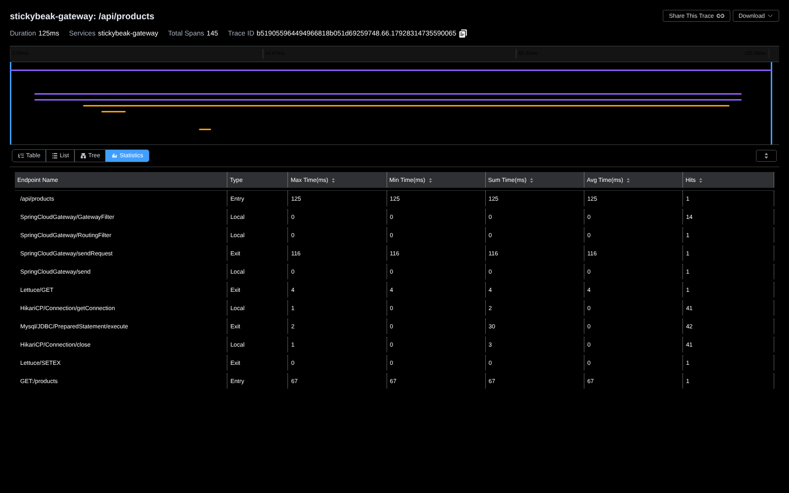
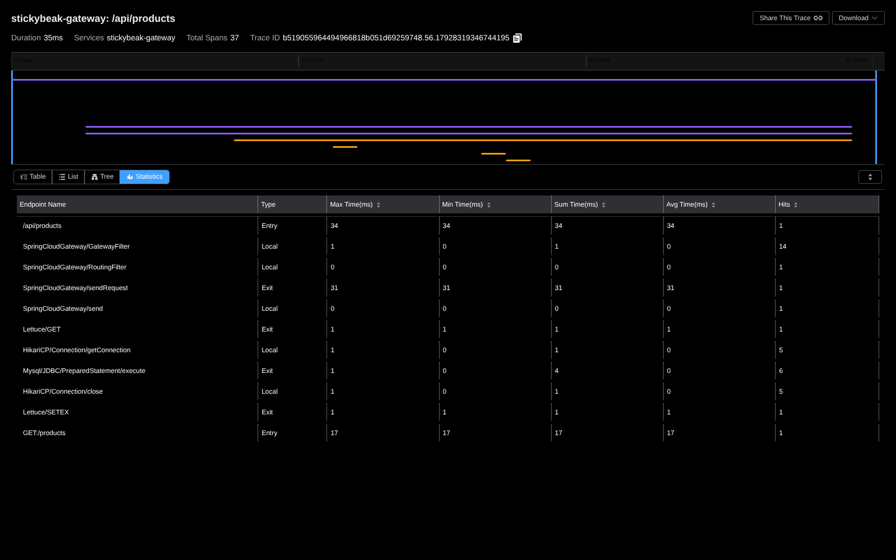
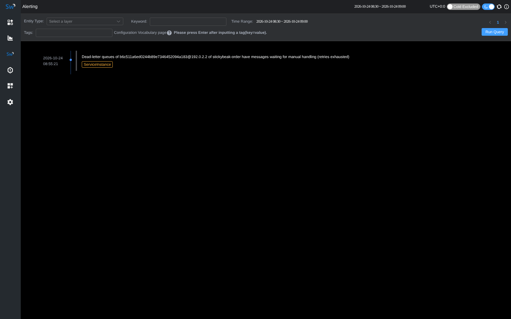

# 用 SkyWalking 链路定位并优化商品列表（Issue 12.5）

商品列表 `GET /api/products` 是商城流量最大的接口（首页、分类页、搜索结果都走它）。
接入 SkyWalking 后，从链路里看出它有 N+1 查询，并发时大部分时间花在等数据库连接上。
改成批量查询后，同样压力下吞吐提升约 3 倍，p99 从 1.57s 降到 392ms。

## 为什么选商品列表，而不是结账

计划里原本写的是压测结账接口。我们看了结账链路（见下文"链路示例"）后，改成优化商品列表：

- 结账在热点商品上本来就是串行的：Redis Lua 预扣、Redisson 锁、Seata AT 全局锁都是为了防超卖有意加的，压测只会测出这些锁。
- 结账流量远小于浏览流量。
- 商品列表每个请求要发 42–50 条 SQL，这是链路里最明显的问题。

## 问题：链路里看到了什么

优化前，一个请求（一页 12 个商品）的链路统计如下（SkyWalking UI → Trace → Statistics）：



| 指标 | 数值 |
|---|---|
| `Mysql/JDBC/PreparedStatement/execute` | 42 次 |
| `HikariCP/Connection/getConnection` | 41 次 |
| span 数 | 145 |

`ProductServiceImpl#enrichProduct` 对每个商品分别查分类、图片、标签关联、标签名：

- 固定 2 条 SQL：count 和分页查询。
- 每个商品 3 条：分类、图片、标签关联。
- 有标签的商品再多 1 条：查标签名。

所以一页是 42–50 条 SQL。每条 SQL 都单独借还一次连接，因为没有事务，MyBatis 用完就归还。

单个请求时这些 SQL 只要几十毫秒，并发下才暴露问题。用 `wrk -t4 -c32` 压测时，取最慢的 5 条链路，看商品服务内部的耗时构成：

| 链路总耗时 | 商品服务入口 | SQL 条数 | SQL 执行合计 | 等待连接（getConnection）合计 |
|---|---|---|---|---|
| 1854ms | 1782ms | 50 | 313ms | **1413ms** |
| 1959ms | 1687ms | 50 | 508ms | **1035ms** |
| 2120ms | 1806ms | 50 | 780ms | **815ms** |
| 2136ms | 1897ms | 50 | 625ms | **863ms** |

结论：瓶颈不在 SQL 本身，而在连接池。

- HikariCP 默认 10 个连接，32 个并发请求各自要借还 50 次连接。
- 线程大部分时间在 `getConnection` 上排队，每次借到连接也只执行一条毫秒级的 SQL。

## 修复：批量补全

新增 `enrichProducts(List<Product>)`，不管一页多少商品，都只发 4 条 SQL：

1. `categoryMapper.selectBatchIds(分类 ID)`
2. `productImageMapper.selectList(product_id IN (...) ORDER BY product_id, sort_order)`
3. `productTagRelMapper.selectList(product_id IN (...) ORDER BY id)`
4. `tagMapper.selectBatchIds(标签 ID)`

在内存里按商品分组后组装 VO，输出顺序与输入一致。

- 列表、ES 搜索结果、按 ID 批量查、精选商品、相关商品都改用它。
- 单个商品详情也复用同一个方法。
- 单元测试 `listProducts_enrichesAWholePageWithFourQueries` 锁定"一页 4 条补全 SQL"，防止回退。

优化后同一个请求：



| 指标 | 优化前 | 优化后 |
|---|---|---|
| SQL 条数 | 42–50 | 6（count + 分页 + 4 条补全） |
| 借连接次数 | 41–49 | 5 |
| span 数 | 145–169 | 37 |
| 单请求耗时（网关入口，无并发） | 125ms | 35ms |

## 压测结果

| | 优化前 | 优化后 | 变化 |
|---|---|---|---|
| 吞吐 | 64.28 req/s | 191.49 req/s | ×2.98 |
| 平均延迟 | 504.69ms | 168.02ms | −67% |
| p50 | 476.49ms | 156.83ms | −67% |
| p75 | 600.82ms | 206.44ms | −66% |
| p90 | 746.11ms | 270.23ms | −64% |
| p99 | 1.57s | 391.96ms | −75% |
| 超时 | 3 | 0 | |

优化后最慢的几条链路在 0.45–0.5s，其中等连接只有 1–32ms，不再是主要耗时。

隔一段时间复测优化后的版本（JVM 更热）：284.32 req/s，p50 106ms，p99 290ms，最慢链路等连接 9–25ms。上表用的是前后紧挨着跑的两次结果，便于对比。

## 测试方法（可复现）

- 环境：同一台机器上运行 MariaDB 10.11、Redis、RabbitMQ、OAP 10.4.0 + BanyanDB 0.10.3 和 7 个服务。
  - 每个服务挂 SkyWalking agent 9.7.0，`-Xmx384m`。
  - 商品服务使用默认 HikariCP 配置（10 个连接）。
- 数据：48 个在售商品，177 张图片，90 条标签关联。
- 压测命令：
  ```bash
  # 先预热 10 秒，再正式压 30 秒
  wrk -t4 -c32 -d30s --latency -s list-nocache.lua http://127.0.0.1:8080
  ```
- 请求脚本：每个请求带一个随机的 `maxPrice`，取值远大于所有商品价格，所以查询结果不变，但能绕过 60 秒的列表缓存，让每个请求都真正查库：
  ```lua
  request = function()
    local path = "/api/products?page=1&size=12&maxPrice=" .. math.random(100000, 999999999)
    return wrk.format("GET", path)
  end
  ```
- 耗时构成的统计方法：
  1. 用 OAP GraphQL `queryTraces`（按耗时排序）取最慢的 5 条链路。
  2. 用 `queryTrace` 拉全部 span。
  3. 对商品服务内的 span 按名字分别汇总耗时：`HikariCP/Connection/getConnection` 记为等待连接，`Mysql/JDBC/*` 记为 SQL 执行。
- 注意：
  - 数字来自开发机，绝对值只用于前后对比。
  - agent 本身也有开销：优化前每个请求 169 个 span，这部分开销也随之减少。

## 链路示例

除了这次优化，链路还能直接看出跨服务和跨 MQ 的调用关系。下面两条都来自本地环境，省略了网关过滤器、连接池等 span。

结账（gateway → order → cart / product / payment）。30 分钟后，延迟队列触发的关单也挂在同一条链路上：

```
/api/orders/checkout                                   gateway   4718ms   (冷启动后第一单)
└ POST:/orders/checkout                                order
  ├ GET:/cart                                          cart      Redis
  ├ POST:/products/stock/deduct                        product   Lua 预扣 → Redisson 锁 → UPDATE t_product → INSERT t_stock_hold → commit
  ├ INSERT t_order / t_order_item / t_order_status_history → commit
  ├ RabbitMQ order.delay.routing (Producer)
  │   └ +30min  order.close.routing (Consumer)          order     超时关单检查
  └ POST:/payments/checkout-session                    payment   INSERT t_payment_record → commit
```

支付回调（payment → `order.paid` → order + notification，异步链路）：

```
/api/webhooks/mock                                     gateway    532ms
└ POST:/webhooks/mock                                  payment    幂等记录 → 更新支付记录
  ├ RabbitMQ order.paid (Producer)                     ← 在事务提交前发送，见 WebhookServiceImpl 注释
  │ ├ order.paid (Consumer)                            order      PAID + 状态历史 → POST /products/stock/confirm → DELETE /cart
  │ └ order.paid (Consumer)                            notification
  └ UPDATE t_payment_webhook → commit
```

经网关转发到后端服务的响应都带 `X-Trace-Id` 头。用它可以在 SkyWalking UI 里打开对应链路，也能查到各服务带同一 traceId 的日志。

## 告警

死信队列积压告警的实测：

- 往 `order.status.dlq` 放 1 条消息后，约 1 分钟内触发告警。
- 告警规则见 `docker/skywalking/alarm-settings.yml`。
- 积压指标来自订单服务上报的 `order_dlq_backlog`。


