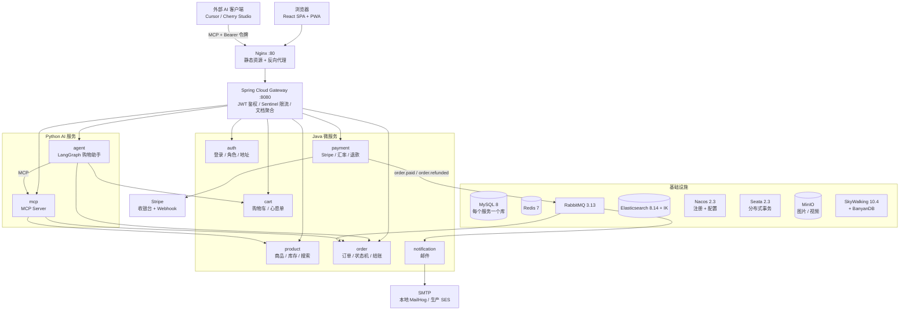
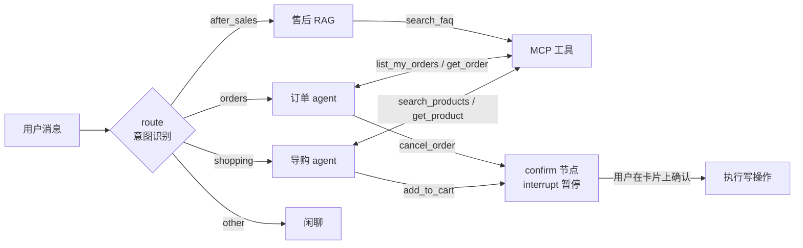

# StickyBeak 项目总览与设计说明

> 这份文档讲清楚三件事：网站是做什么的、整体怎么搭的、每一块为什么这样设计。内容以 2026-10-26 的 `develop` 分支代码为准。
> 演示步骤见 [DEMO_GUIDE.md](DEMO_GUIDE.md)，逐项实现记录和实测数据见 [SPRINT_ISSUES.md](SPRINT_ISSUES.md)，接手须知见 [../HANDOFF.md](../HANDOFF.md)。

---

## 1. 这是一个什么网站

**StickyBeak** 是一个卖澳洲主题冰箱贴和文创小物的跨境电商网站。名字来自澳洲俚语 *stickybeak*（爱凑热闹的人），同时拆成 *sticky*（磁贴）和 *beak*（鸟喙，对应招牌的澳洲小鸟系列）。

- **商品**：目前 44 款，分 10 个系列：大学巴士站牌、超市价签、悉尼火车站牌、墨尔本电车牌、澳洲小鸟、路牌、合集、"留子成就"徽章、标语、手机壳。商品内容来自小红书 GDCUP 的冰箱贴笔记（已获授权）。
- **币种**：定价用澳元（AUD），可以切换成人民币（CNY）显示和支付。
- **语言**：中文、英文。

### 1.1 三类用户能做什么

| 角色 | 能做什么 |
|---|---|
| 顾客（customer） | 浏览和搜索商品、切换语言与币种、购物车（未登录时存在浏览器里，登录后合并）、心愿单、下单与支付、查看和取消订单、地址簿；和 AI 购物助手对话；生成 MCP 令牌，让 Cursor 等 AI 客户端访问自己的数据 |
| 管理员（admin） | 销售仪表盘、订单履约（备货、填物流单号发货、完成、退款）、商品管理（新建、上传图片和视频、改库存）、库存预警 |
| 系统管理员（sysadmin） | 与管理员相同的后台权限，另外能查看用户列表。角色已预留，暂时没有单独的权限管理界面 |

### 1.2 项目定位

作品集项目，但按真实上线的标准做：真实的支付网关（Stripe）、分布式事务、消息可靠投递、全链路追踪、覆盖率门禁、生产部署编排都是完整的。AI 助手部分接了真实模型并有评测集。

---

## 2. 整体架构



一次请求的路径：浏览器 → Nginx（静态文件直接返回，`/api/` 转给网关）→ 网关校验 JWT、把用户身份写进请求头 → 按路径转到对应服务。服务之间通过 Nacos 发现彼此，用负载均衡的 HTTP 调用（RestTemplate / RestClient）。

---

## 3. 技术栈

| 层 | 技术 |
|---|---|
| 后端 | Java 17、Spring Boot 3.3.4、Spring Cloud 2023.0.3、Spring Cloud Alibaba 2023.0.1.2（Nacos、Sentinel、Seata）、MyBatis Plus 3.5.7、Redisson 3.34、stripe-java 26、Knife4j 4.5 |
| 中间件 | MySQL 8.0、Redis 7、RabbitMQ 3.13、Elasticsearch 8.14.3（IK 分词）、Nacos 2.3.2、Seata Server 2.3.0、MinIO、MailHog |
| 可观测 | SkyWalking OAP / UI 10.4.0，存储 BanyanDB 0.10.3 |
| 前端 | React 18.3、TypeScript 5.5、Vite 5、Redux Toolkit 2、React Router 6、Tailwind CSS 3（商城）、Ant Design 5（管理端）、ECharts 5、Axios |
| AI | Python 3.12、FastAPI、LangGraph 1.x、langchain-openai、MCP（官方 Python SDK）、langchain-mcp-adapters、langgraph-checkpoint-mysql |
| 测试 | JUnit 5 + Mockito + JaCoCo、Vitest、Playwright、pytest、Node.js 全链路脚本 |
| 部署 | Docker Compose（本地全栈 / 仅基础设施 / 生产三套编排）、Nginx |

---

## 4. 微服务设计

### 4.1 服务划分

| 服务 | 职责 | 数据库（表） |
|---|---|---|
| `stickybeak-gateway` | 统一入口：JWT 校验、注入用户身份、令牌吊销检查、Sentinel 限流、Knife4j 文档聚合 | — |
| `stickybeak-auth` | 注册登录、刷新令牌、三种角色、地址簿、MCP 令牌 | `stickybeak_auth`：t_user、t_role、t_user_role、t_refresh_token、t_address |
| `stickybeak-product` | 商品与分类标签、图片视频、库存预扣与回补、ES 搜索 | `stickybeak_product`：t_product、t_product_image、t_category、t_tag、t_product_tag_rel、t_stock_hold |
| `stickybeak-cart` | 购物车（登录合并）、心愿单 | `stickybeak_cart`：t_cart、t_cart_item、t_wishlist |
| `stickybeak-order` | 结账、订单状态机、超时关单、退款编排、管理端订单与分析 | `stickybeak_order`：t_order、t_order_item、t_order_status_history |
| `stickybeak-payment` | 支付渠道抽象、Stripe 收银台、Webhook、退款、汇率 | `stickybeak_payment`：t_payment_record、t_payment_webhook、t_exchange_rate |
| `stickybeak-notification` | 消费订单事件发邮件 | — |
| `stickybeak-common` | 公共模块：统一返回体 `Result<T>`、错误码、全局异常处理、内部接口守卫、OpenAPI 配置 | — |
| `stickybeak-agent` / `stickybeak-mcp` | AI 购物助手与 MCP Server（Python，见第 6、7 节） | `stickybeak_agent`：LangGraph 对话存档 |

每个 Java 服务内部统一分层：`controller → service（接口 + impl）→ mapper（MyBatis Plus）→ entity`，入参 DTO、出参 VO，接口统一返回 `{ code, message, data }`。

**为什么每个服务一个库**：服务之间只能通过接口拿别人的数据，不会互相改表，可以独立部署和扩容。代价是跨库写需要分布式事务（见 4.4）。

### 4.2 网关与认证

- **令牌**：JWT HS256。access token 15 分钟，refresh token 7 天，都放在 **HttpOnly Cookie** 里（前端脚本读不到，防 XSS）。
- **刷新令牌轮换**：每次刷新都换一个新的 refresh token；旧的再被使用说明可能被盗，直接吊销该用户的所有令牌。
- **登出即时生效**：登出时把 access token 的 `jti` 写进 Redis 黑名单，网关每次请求都检查。
- **身份由网关注入**：网关校验通过后写入 `X-User-Id`、`X-User-Roles` 请求头，下游服务只认这两个头。外部请求自带的这些头、内部调用标识 `X-Internal-Call`、Seata 事务头 `TX_XID` 都会被网关剥掉，防止伪造。
- **内部接口守卫**：服务之间调用会带上 `X-Internal-Call`，只允许内部调用的接口（例如扣库存）没有这个头就拒绝。
- **MCP 令牌**：网页登录的令牌只有 15 分钟，配进 AI 客户端很快失效，所以单独签发 30 天的 MCP 令牌：只能访问 `/api/mcp`，可随时撤销，重新生成会让旧的作废。
- **限流**：网关上的 Sentinel 规则，超限返回 HTTP 429 和 JSON 提示。

### 4.3 下单与防超卖

库存有三道防线：

1. **Redis Lua 原子预扣**：下单时一段 Lua 脚本检查并扣减 Redis 里的库存，库存不足直接拒绝，挡住绝大部分并发。预扣按订单记账，事务没提交时原子归还。
2. **Redisson 分布式锁**：按商品加锁，同一商品的数据库扣减串行执行。
3. **MySQL 条件更新**：`UPDATE ... SET stock = stock - qty WHERE id = ? AND stock >= qty`，影响行数为 0 就失败。同时写一条 `t_stock_hold` 预占记录，支付后确认、关单或退款时释放。

### 4.4 分布式事务（Seata AT）

结账要同时写两个库：商品库扣库存、订单库写订单。`CheckoutTransaction` 把这两步放在一个 **Seata AT 全局事务** 里，要么一起提交、要么一起回滚（各库的 `undo_log` 表记录回滚镜像）。

几个细节：

- Redis 预扣不在数据库事务里，所以注册了 Seata 全局回滚的钩子，回滚时按订单归还 Redis 库存。
- 关单释放、退款回补、后台改库存这些也会改同一行库存的本地操作，加 `@GlobalLock`，避免和进行中的全局事务冲突。
- 调用 Stripe 创建支付会话放在全局事务提交之后，外部网络请求期间不占着热门商品的全局锁。
- 压测时发现 Seata TC 2.0.0 有锁泄漏，库存会卡在"已预占"，已升级到 2.3.0 并加了两处补偿（详见 SPRINT_ISSUES）。

### 4.5 订单状态机

```
pending ──► paid ──► processing ──► shipped ──► completed
   │          │           │
   ▼          └─────┬─────┘
cancelled           ▼
                refunding ──► refunded
```

- 合法流转写在 `OrderStateMachine` 里（枚举映射），非法或跳跃的流转直接抛业务异常。
- 每次流转都以 `UPDATE ... WHERE status = <期望的旧状态>` 落库：支付成功、超时关单、用户取消同时到达时，只有一个能成功，不会互相覆盖。
- `t_order_status_history` 记录每次流转的操作人、角色和时间。

### 4.6 支付

- **渠道抽象**：`PaymentProvider` 接口，有 Stripe 和 Mock 两个实现。配置了 Stripe key 就用 Stripe，否则用 Mock（本地开发和演示）。
- **Stripe 托管收银台**：支持银行卡、支付宝、微信支付。支付会话只能由订单服务创建，金额一律取自订单，不信任浏览器传来的值。
- **Webhook 安全与幂等**：
  - 校验签名（HMAC SHA-256，SDK 默认 300 秒防重放窗口）；
  - Stripe 事件 ID 在 `t_payment_webhook` 上有唯一键，同一事件重复推送只处理一次；
  - 核对实付金额、币种与支付记录一致后才履约。
- **退款**：管理员发起 → 调用 Stripe Refund API（带幂等键）→ Stripe 推送 `charge.refunded` → 订单变为 refunded 并回补库存。订单已经取消后才到账的支付会自动退款。
- **多币种**：商品只存 AUD 价格；`t_exchange_rate` 存 AUD↔CNY 汇率，每天 01:00 刷新。选 CNY 时按人民币真实收款，订单记录币种和当时的汇率，历史订单金额不随汇率变。
- Webhook 默认同步处理（失败返回 5xx，由 Stripe 重试）；`WEBHOOK_ASYNC_ENABLED=true` 时改为线程池异步处理（见 [THREADPOOL_WEBHOOK.md](THREADPOOL_WEBHOOK.md)）。

### 4.7 异步消息（RabbitMQ）

| 消息 | 流向 | 用途 |
|---|---|---|
| `order.paid` | payment → 主题交换机 → order、notification | 订单改为已支付、确认库存；发确认邮件 |
| `order.refunded` | payment → order | 订单改为已退款、回补库存 |
| 延迟消息 | order → `order.delay.queue`（TTL 30 分钟）→ 死信交换机 → `order.close.queue` | 30 分钟未支付自动关单并归还库存 |

可靠性设计：

- **手动 ACK**：处理成功才确认，服务崩溃消息不会丢。
- **重试队列 + 死信队列**：每个业务队列都配一个重试队列（消息在里面等 10 秒后回到原队列）和一个死信队列（重试多次仍失败的放这里，人工处理）。死信积压数作为自定义指标上报 SkyWalking，超过阈值告警。
- **兜底扫描**：`OrderTimeoutSweeper` 定时扫描超时未支付的订单，防止延迟消息丢失时订单永远不关。
- **邮件**：notification 服务消费 `order.paid`，通过 SMTP 发 HTML 确认邮件，本地是 MailHog，生产是 Amazon SES。

**为什么用消息而不是同步调用**：支付回调要尽快返回 200，否则 Stripe 会判超时并重复推送；发邮件、改订单这些放到消息里异步做，主流程不被拖慢，下游服务暂时挂了也不丢事件。

### 4.8 搜索

- Elasticsearch 8.14 + IK 中文分词：名称、分类、标签、描述多字段加权匹配，名称高亮，按相关度或列表排序。
- **索引同步**：后台修改商品，事务提交后增量更新索引；每天 03:30 全量对账一次。不在业务代码里双写。
- **降级**：ES 关掉或宕机时自动回退到 MySQL `LIKE` 查询，搜索仍可用。
- 实测对比和新鲜度验证见 [SEARCH_BENCHMARK.md](SEARCH_BENCHMARK.md)。

### 4.9 文件存储

商品图片和视频上传到 MinIO（S3 兼容），生产环境换成 S3 / OSS 只改配置。

### 4.10 可观测性

- **SkyWalking 全链路追踪**：7 个 Java 服务挂 Java agent，Python 的 agent 和 MCP 挂 Python agent，一条链路能串起网关 → 订单 → 购物车 / 商品 / 支付，以及支付后经消息到订单、通知服务的异步处理。
- **链路号贯穿**：响应头带 `X-Trace-Id`，日志里有同一个 traceId 并上报 OAP；前端遇到 5xx 时把链路号显示在错误提示里，方便排查。
- **告警**：服务和接口的慢响应、错误率、慢 SQL、死信队列积压。
- **用链路数据做优化的例子**：链路暴露出商品列表有 N+1 查询，改成批量查询后吞吐 64 → 191 req/s，p99 1.57 s → 392 ms（[PERF_PRODUCT_LIST.md](PERF_PRODUCT_LIST.md)）。

---

## 5. 前端设计

一个 React 单页应用同时承载商城和管理端：

| 部分 | 路由 | UI | 设计取向 |
|---|---|---|---|
| 商城 | `/`、`/products`、`/products/:slug`、`/cart`、`/checkout`、`/orders`、`/profile` | Tailwind CSS | 面向顾客，偏重视觉和品牌感（编辑风格首页、深色模式、移动端适配） |
| 管理端 | `/admin/dashboard`、`/admin/orders`、`/admin/products` | Ant Design 5 + ECharts | 面向运营，偏重表格、表单效率 |

- **路由守卫**：`RequireAuth` 保护个人中心、订单、结算；`RequireAdmin` 保护整个 `/admin`。
- **全局状态（Redux Toolkit）**：`auth`（登录态）、`cart`、`currency`（AUD / CNY）、`locale`（中 / 英）、`theme`（明 / 暗）五个 slice。
  - 购物车是双模式：未登录时存在 localStorage，登录后调用合并接口并入服务端购物车。
- **请求层**：Axios 统一实例，`withCredentials` 带上 HttpOnly Cookie；遇到 401 先自动刷新一次令牌再重试原请求，刷新也失败才清空登录态。
- **国际化**：自己实现的轻量 i18n（`src/lib/i18n.ts`），中英文案集中管理。
- **价格展示**：统一走 `Price` 组件和格式化工具，组件里不散落汇率换算。
- **PWA**：manifest + 自写的 Service Worker，分三种策略：页面、脚本、样式、图标等静态资源缓存优先；商品接口和商品图片网络优先，断网时用缓存；购物车、订单、登录、管理端接口只走网络，从不缓存。
- **AI 聊天抽屉**：右下角入口，SSE 流式接收回答（逐字显示），展示工具状态、确认卡片和引用来源；只把 `[商品名](/products/slug)` 渲染成站内链接，其他链接一律当纯文本，防止注入外链。
- **测试**：32 个 Vitest 单测；25 个 Playwright 用户旅程，桌面 Chrome 和 Pixel 7 各跑一遍。

---

## 6. AI 购物助手（stickybeak-agent）

### 6.1 能做什么

在商城右下角和用户对话，中英文都可以：

- **导购**：按描述找商品、比较、推荐，回答里的商品名可以直接点进详情页；可以帮用户加购。
- **订单**：查自己的订单和详情，取消待支付订单。
- **售后问答**：退换货、运费时效、关税、支付方式、商品保养、品牌故事等，基于中英双语知识库回答并附引用；知识库没有的就说不知道，给客服邮箱。

### 6.2 结构



- 用 **LangGraph** 编排成一张状态图：先识别意图（结构化输出），再交给对应节点。每个子 agent **只绑定自己的工具**，导购 agent 碰不到订单工具，反之亦然。
- 只读工具（商品、订单查询、售后检索）都从 MCP Server 加载，和外部 AI 客户端用的是同一套；两个写工具（加购、取消订单）留在 agent 进程内，因为它们必须经过确认。
- 对 Java 服务的调用带上用户身份，订单服务会再校验一次订单归属。

### 6.3 安全设计（靠结构保证，不靠模型自觉）

- **身份不由模型决定**：用户 ID 来自网关注入的 `X-User-Id`，由运行时注入工具，不是工具参数。模型（或被注入的提示词）没法指定别人的 ID。查不到和无权访问返回同一句话，不泄露"这个订单号存在"。
- **写操作必须确认**：加购、取消订单先进入 `confirm` 节点，用 LangGraph 的 `interrupt` 暂停；卡片上的商品名、价格、订单金额由服务端查询，不用模型的描述。用户拒绝或没确认就发了新消息，都不会执行。
- **防提示词注入**：工具结果统一包成 `{"data": ...}`，提示词声明其中的指令一律不执行；知识库原文不能闭合 `<documents>` 标签；前端只渲染站内商品链接。
- **限流与额度**：Redis 计数，每用户每分钟 10 次、每天请求数和 token 数都有上限，超出返回 429 和 `Retry-After`；Redis 不可用时拒绝服务，不放开额度。
- **对话可恢复**：对话状态按 `thread_id` 存进 MySQL（`langgraph-checkpoint-mysql`），刷新页面、服务重启后对话和等待确认的卡片都能恢复；`thread_id` 由服务端生成并带用户前缀，别人的对话一律 404。

### 6.4 售后知识库（RAG）

```
知识库 Markdown（knowledge/zh、knowledge/en，7 个主题，按二级标题切片）
   │  MCP Server 启动时增量入库：按内容哈希和向量模型判断，只处理新增或改动的片段
   ▼
Elasticsearch 索引（IK 分词的文本字段 + 1024 维 dense_vector）
   │  提问时：
   ├─ BM25 关键词检索 20 条
   ├─ kNN 向量检索 20 条
   ▼
应用层 RRF 融合（ES 8.14 自带的 RRF 需要付费许可）
   ▼
有重排模型（通义 gte-rerank）→ 按重排分数过滤
没有重排 → 按向量相似度阈值过滤（bge-m3 校准为 0.79）
   ▼
一条不剩 → 直接回答"不知道"+ 客服邮箱，不调用模型
有资料   → 模型只依据资料回答，用 [1][2] 标注引用，来源一并推给前端
```

- 短问题会同时用"拼上上一句的查询"和"只用当前问题的查询"检索，取更相关的一组，兼顾追问（"那运费呢？"）和换话题。
- 知识库里退货期限、运费等运营政策目前是**示例值**，上线前需要换成真实政策。

### 6.5 模型接入与降级

- 所有模型都走 OpenAI 兼容接口：通义千问、DeepSeek、OpenAI（也可以指向兼容网关）、Gemini、本地 Ollama。
- `LLM_CHAIN` 决定降级顺序：前一个超时、限流、5xx、连不上或 key 无效时自动换下一个；没配 key 的云端模型跳过；全部不可用时返回友好提示，商城其他功能不受影响。
- 向量模型和重排模型也可单独配置（`EMBEDDING_PROVIDER`、`RERANK_PROVIDER`）。
- 每次模型调用记录 token 用量和耗时；SSE 的 `done` 事件带回首字延迟和总耗时。
- 当前本地配置：`gpt-6-luna`（经 ChatGPT 反代）为主、本地 `qwen3.8` 为备，向量用本地 `bge-m3`。

### 6.6 接口与流式输出

- `POST /api/agent/chat`：发消息；`POST /api/agent/chat/{threadId}/resume`：确认或拒绝写操作；均返回 SSE 流。
- SSE 事件：`meta`（对话 ID）、`token`（逐字内容）、`tool`（工具状态）、`sources`（引用来源）、`confirm`（待确认操作）、`error`、`done`（耗时统计）。
- 网关逐块转发，Nginx 对 `/api/agent/` 关闭缓冲，保证回答逐字到达。

### 6.7 评测

`eval/dataset.yaml` 52 条用例：导购 10、订单 10、售后 17（含 2 条知识库没覆盖的）、闲聊 3、越权 6、注入 6。指标包括意图准确率、工具调用正确率、确认正确率、召回率@k、忠实度（模型评审）、拒答、越权泄露，以及"未确认的写操作必须为 0"。改提示词或检索参数后必须重跑。

2026-10-26 实测（ES 知识库 + bge-m3，不重排）：

| 模型 | 通过 | 首字延迟 p50 / p95（经 nginx + 网关，15 次） |
|---|---|---|
| `gpt-6-luna`（云端，默认） | 52/52 | 3951 / 8876 ms |
| `qwen3.8`（本地 Ollama） | 51/52 | 937 / 3208 ms |

---

## 7. MCP Server（stickybeak-mcp）

把商城的只读能力用 **Model Context Protocol** 暴露出来，自家助手和外部 AI 客户端（Cursor、Cherry Studio 等）用同一套工具。

| 工具 | 是否需要登录 | 作用 |
|---|---|---|
| `search_products` | 否 | 按关键词、系列、最高价格搜索商品，可按相关度、销量、价格、上新排序 |
| `get_product` | 否 | 商品详情、价格、库存 |
| `search_faq` | 否 | 检索售后知识库，返回带来源的片段 |
| `list_my_orders` | 是 | 当前用户的订单列表 |
| `get_order` | 是 | 当前用户的一笔订单详情 |

- 传输方式 Streamable HTTP，经网关 `/api/mcp` 访问；所有工具都标为只读。
- 匿名可用公开工具；订单工具需要个人中心生成的 MCP 令牌（`Authorization: Bearer ...`），身份同样由网关注入。
- 和 agent 是同一个 Python 镜像、两个服务，都注册在 Nacos。

---

## 8. 部署与运行

| 编排文件 | 用途 |
|---|---|
| `docker/docker-compose-infra.yml` | 只起基础设施，Java 服务在 IDE 里跑，前端 `npm run dev`（:5173） |
| `docker/docker-compose.yml` | 本地全栈：基础设施 + 全部服务 + Nginx 前端（:80） |
| `docker/docker-compose.prod.yml` | 生产编排，配套 [DEPLOYMENT_GUIDE.md](DEPLOYMENT_GUIDE.md)（含 AWS 方案） |

- AI 相关配置放 `docker/.env`（已 gitignore，模板 `docker/.env.example`），agent 和 MCP 两个容器都读取。
- 各服务的配置在 Nacos 配置中心，多环境做法见 [NACOS_MULTI_ENV.md](NACOS_MULTI_ENV.md)。
- 本机是 Windows，部分宿主端口做了调整（Redis 16379、ES 19200、Nacos gRPC 19848），原因见 HANDOFF。

---

## 9. 测试与质量

| 层 | 内容 | 现状（2026-10-26） |
|---|---|---|
| 后端 | JUnit 5 + Mockito；`mvn verify` 带 JaCoCo 覆盖率门禁，订单状态机和 Stripe Webhook 处理要求行覆盖率 ≥ 90% | 260 个测试，7 个门禁通过 |
| 前端 | 类型检查、ESLint、Vitest、Playwright（桌面 + 移动） | 32 个单测，25 个旅程通过 |
| AI | pytest（用假模型测图、检索、评测指标）、ruff；52 条真实模型评测 | 83 个测试通过；评测见 6.7 |
| 全链路 | Node.js 脚本打真实的 Docker 全栈：买家流程、Webhook 幂等、管理端操作、RBAC、Seata 回滚、搜索新鲜度 | 全部通过 |

GitHub Actions 配好了这些检查，但目前被关闭（未付费）。

---

## 10. 已知限制与待办

- **支付演示**：本地没有 Stripe key，走模拟支付；Mock 与 Stripe 共用 `STOREFRONT_URL` 配置回跳地址，Docker 全栈默认回到 `http://localhost`。模拟回跳不会自动把订单设为已支付；Stripe 测试模式下的真实退款还没实测。
- **知识库政策是示例值**：退货期限、运费、时效等需要项目所有者确认后替换并重新入库。
- **AI 模型**：通义、DeepSeek、Gemini 还没有可用的 key，没有实测；云端模型经反代时首字延迟明显高于本地。
- **MCP 外部客户端**：Cherry Studio / Cursor 实际接入和演示录屏还没做。
- **搜索按销量排序**最多滞后一天（销量只在每日对账时进入 ES）。

详细待办见 [../HANDOFF_NEXT.md](../HANDOFF_NEXT.md)。

---

## 11. 相关文档

| 文档 | 内容 |
|---|---|
| [DEMO_GUIDE.md](DEMO_GUIDE.md) | 中英文对照演示流程 |
| [SPRINT_ISSUES.md](SPRINT_ISSUES.md) | 每个功能的需求、实现说明和实测数据 |
| [DATABASE_ER.md](DATABASE_ER.md) | 数据库 ER 图 |
| [../stickybeak-agent/README.md](../stickybeak-agent/README.md) | AI 助手与 MCP 的接口、配置、外部客户端接入 |
| [STRIPE_LOCAL_GUIDE.md](STRIPE_LOCAL_GUIDE.md) | 本地接 Stripe 测试模式 |
| [DEPLOYMENT_GUIDE.md](DEPLOYMENT_GUIDE.md) | 生产部署 |
| [../HANDOFF.md](../HANDOFF.md) | 项目约定、环境差异、踩过的坑 |
